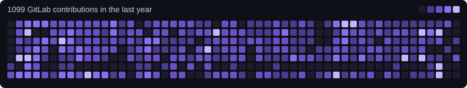

<!-- ===================== HEADER ===================== -->
<div align="center">


<a href="https://github.com/ridoan777">
  
</a>

<br/>

[](https://www.linkedin.com/in/ridoankabir/)
[](mailto:ridoan777kabir@gmail.com)
[](https://gitlab.com/ridoan)


</div>

<br/>

<!-- ===================== ABOUT ===================== -->

## 👨‍💻 About

Software Developer with **2+ years of industry experience delivering 40+ client projects** for international and local businesses, with a vision to build scalable software products that solve real problems.

Engineering focus: **secure access control, audit-ready data, reliable payments and clean, extensible architecture.**

<br/>

<div align="center">

<table>
  <tr>
    <td align="center" valign="top" width="150"><h2>2+</h2><sub>Years in industry</sub></td>
    <td align="center" valign="top" width="150"><h2>40+</h2><sub>Client projects delivered</sub></td>
    <td align="center" valign="top" width="150"><h2>8</h2><sub>Apps live on App Store & Play Store</sub></td>
    <td align="center" valign="top" width="150"><h2>52</h2><sub>Projects worked on (incl. ongoing)</sub></td>
  </tr>
</table>

</div>

<br/>

<!-- ===================== GITLAB GRAPH ===================== -->
## 📊 Coding Activity

<div align="center">


<br/>
<a href="https://gitlab.com/ridoan"><b>View my GitLab profile →</b></a>

</div>
<br/>
<!-- ===================== TECH STACK ===================== -->

## 🧰 Tech Stack

<div align="center">


<br/>


</div>

| Area | Skills |
| :-- | :-- |
| **Languages** | PHP · Python · SQL · JavaScript |
| **Frameworks** | Laravel · Livewire · WordPress · React.js · Next.js |
| **Databases** | MySQL · PostgreSQL · Redis |
| **Infrastructure** | AWS (S3, CloudFront) · Linux Server Management (Nginx, VPS) · GitLab CI/CD |
| **Integrations** | Stripe · RevenueCat · WebSockets · AI Integrations |
| **Concepts** | OOP · DSA · RBAC · ABAC · RESTful APIs · Background Processing · SDLC · Agile |

<br/>

<!-- ===================== FEATURED WORK ===================== -->

## 🚀 Featured Work

<table>
  <tr>
    <td width="50%" valign="top">
      <h3>💪 BP Fitness</h3>
      Backend of a US-based fitness business serving <b>1,000+ on-site customers</b>.<br/><br/>
      <sub><b>Challenge:</b> dual payment systems, LMS, e-commerce and AI-powered workflows in one platform.</sub><br/><br/>
      <a href="https://gitlab.com/corporate-projects1/bp-fitnesss">Git</a> · <a href="https://apps.apple.com/us/app/bpfitnes/id6757735124">App Store</a>
    </td>
    <td width="50%" valign="top">
      <h3>⚡ Sparky Bot</h3>
      Standards-based calculation engine for an Oceania electricians' app, covering cable sizing and voltage drop.<br/><br/>
      <sub><b>Challenge:</b> translated AS/NZS 3008 tables and formulas into calculation modules with industry-grade accuracy.</sub><br/><br/>
      <a href="https://github.com/ridoan777/Sparky-Bot">Git</a> · <a href="https://apps.apple.com/au/app/sparkybot/id6754190924">App Store</a>
    </td>
  </tr>
  <tr>
    <td width="50%" valign="top">
      <h3>🎵 Tom's Performance Studio</h3>
      Full-stack of a school-management system serving <b>1,400+ enrolled students and 40+ teachers</b> at an Australian music school.<br/><br/>
      <sub><b>Challenge:</b> flexible payment handling for private and group class enrollments with schedule tracking.</sub><br/><br/>
      <a href="https://github.com/ridoan777/Toms-Studio">Git</a> · <a href="https://tomsperformancestudio.cloud/">Frontend</a>
    </td>
    <td width="50%" valign="top">
      <h3>🎓 Futures Behavior Analysis</h3>
      Learning Management System backend for a US-based Applied Behavior Analysis education provider.<br/><br/>
      <sub><b>Stack:</b> Laravel · Subscriptions · AWS (S3, CloudFront)</sub><br/><br/>
      <a href="https://github.com/ridoan777/Future-Behaviour-Analysis">Git</a> · <a href="https://futuresbehavioranalysis.com">Frontend</a>
    </td>
  </tr>
  <tr>
    <td colspan="2" valign="top">
      <h3>📝 Notepaper <sup>(personal project)</sup></h3>
      Independently designed and developed multi-user, cloud-based note-management SPA.<br/><br/>
      <sub><b>Stack:</b> Laravel · Livewire v3 · Cloudflare · MySQL</sub><br/><br/>
      <a href="https://github.com/ridoan777/notepaper">Git</a> · <a href="https://www.notepaper.ridoan.com/">Website</a>
    </td>
  </tr>
</table>

<br/>

<!-- ===================== TECHNICAL ACHIEVEMENT ===================== -->

## 🏆 Technical Achievement

<details open>
<summary><b>RevenueCat Integration for Laravel</b> (built in-house, deployed to production)</summary>
<br/>

| | |
| :-- | :-- |
| **Challenge** | The Laravel ecosystem lacked a mature, reliable solution for native RevenueCat integration. |
| **Achievement** | Architected a complete in-house RevenueCat abstraction layer from scratch, researching, mocking and validating first-party events, entitlements, lifecycles and cross-platform behavior (iOS, Android). |
| **Adoption** | Reused across numerous production SaaS, multi-tenant and multi-vendor applications. |
| **Delivery** | 3-4 weeks · Team of 2 engineers (1 Laravel, 1 Flutter) |

</details>

<br/>

<!-- ===================== EXPERIENCE ===================== -->

## 💼 Experience

```text
AUG 2025 ─ Present   Software Developer · Softvence Ltd, Dhaka
                     • Delivered 25+ production-ready backend systems for international clients
                     • Implemented strict RBAC, automated database backups and audit logging
                       for transaction traceability and data integrity
                     • Collaborated with Flutter, React, QA and Sales teams

JUL 2024 ─ JUL 2025  Web Developer · Neutra AI, Dhaka
                     • Built web applications, admin tools and office management systems
                       for 20+ local and international B2B clients
                     • Delivered SEO-friendly WordPress and WooCommerce websites
```

<br/>

<!-- ===================== EDUCATION ===================== -->

## 🎓 Education & Training

- **B.Sc. in Computer Science & Engineering**, Northern University Bangladesh (2024) · CGPA 3.46 / 4.00
- **PHP with Laravel Framework**, Virtual Pondit (SEIP, BASIS) · 2023
- **Laravel Developer Internship** (remote, part-time alongside a full-time role), Business Automation Ltd. · 2024

<br/>

<!-- ===================== GITHUB STATS ===================== -->

<div style="display: none;">
## 📊 GitHub Activity

<div align="center">


<a href="https://gitlab.com/ridoan"><b>More of my coding activity on GitLab →</b></a>

</div>
</div>
<br/>

<!-- ===================== FOOTER ===================== -->

<div align="center">

### 🤝 Open to building something meaningful

[](https://www.linkedin.com/in/ridoankabir/)
[](mailto:ridoan777kabir@gmail.com)


</div>
